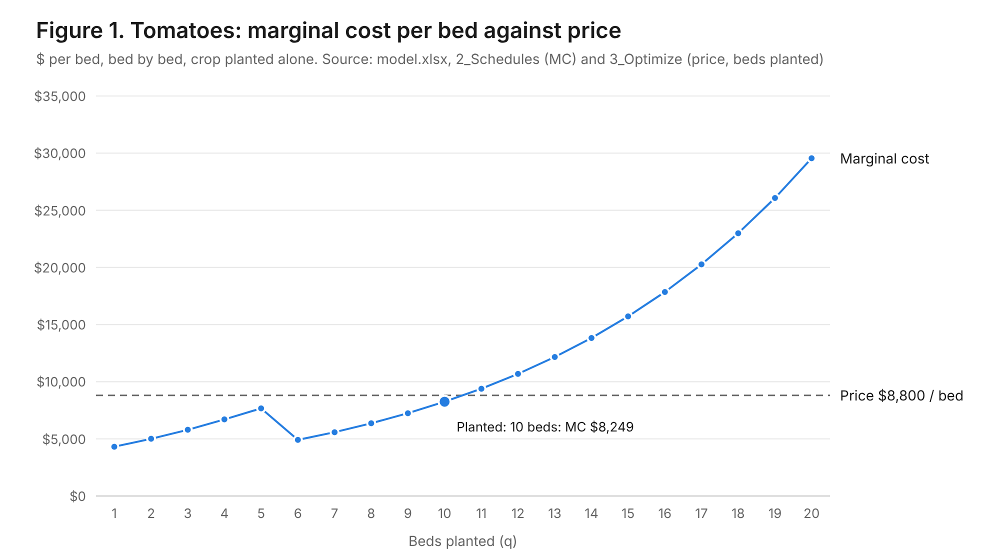
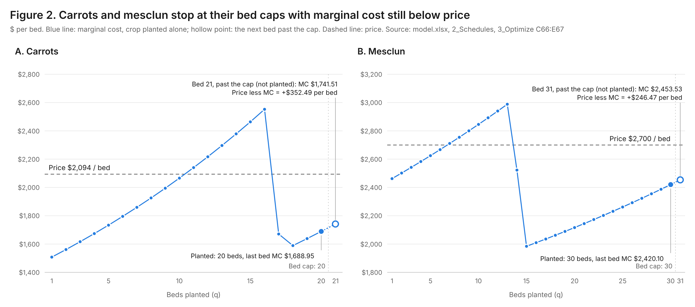

# Perfect competition — analysis

Isaiah Stewart · November 27, 2026

This analysis walks through the marginal costs, capacity caps, and cost benchmarks behind the farm's optimal planting plan of 10 tomato, 20 carrot, and 30 mesclun beds (60 of 64 available beds), which maximizes season profit at $42,761.66.

## 1. Where the money crop stops, and why

*Table 1. Tomato marginal cost at beds 10 and 11 (`4_Results`; price from `1_Inputs`).*

| Tomato bed | MC | Price | Net of that bed |
| --- | --- | --- | --- |
| 10 | $8,248.59 | $8,800 | +$551.41 |
| 11 | $9,390.72 | $8,800 | -$590.72 |

Tomato cap: 20 beds, 10 used.

Tomatoes stop at bed 10 because that is the last bed where price still beats marginal cost, adding $551.41 to profit ($8,800 revenue vs. $8,248.59 MC). Planting bed 11 pushes marginal cost up to $9,390.72, which would lose $590.72 and drag total profit down. That means the price-equals-MC rule stops tomatoes, not the 20-bed cap, since 10 beds of tomato capacity go unused. Even though tomatoes bring in the highest revenue per bed on the farm, revenue alone ignores how fast labor costs climb as you add beds, so profit depends on the gap between price and marginal cost rather than top-line revenue.

Figure 1 tracks tomato marginal cost across beds 1 through 20 against the flat $8,800 price line, showing the cost curve dip once after the 720-hour owner tier and then climb past $8,800 right between beds 10 and 11.

## 2. Which constraints bind, and what relaxing one is worth

*Table 2. Constraints at the optimum (`3_Optimize` Regions C and E; Solver re-runs with each cap raised by one bed).*

| Constraint | Used / limit | Status | One more unit is worth |
| --- | --- | --- | --- |
| Carrot cap | 20 / 20 | Binding | +$352.49 ($2,094 price vs $1,741.51 MC; profit $43,114.16) |
| Mesclun cap | 30 / 30 | Binding | +$246.47 ($2,700 price vs $2,453.53 MC; profit $43,008.14) |
| Total beds | 60 / 64 | Slack (4) | $0 |
| Tomato cap | 10 / 20 | Slack (10) | $0 |
| Temp hours | 4,557.22 / 5,760 | Slack (1,202.78) | $0 |
| Temp workers | 3.165 / 4 | Slack (0.835) | $0 |

Only two Solver constraints bind at the optimum, the 20-bed carrot cap and the 30-bed mesclun cap, while total beds (4 slack), the tomato cap (10 slack), temp hours (1,202.78 slack), and temp workers (0.835 slack) are all slack. Both carrots and mesclun stop because they hit their caps, not because of economics, since a 21st carrot bed would still add $352.49 ($2,094 price vs. $1,741.51 MC) and a 31st mesclun bed would add $246.47 ($2,700 price vs. $2,453.53 MC). Relaxing the carrot cap is worth more by $106.02 per bed, pushing farm profit to $43,114.16 compared to $43,008.14 for an extra mesclun bed. Mesclun earns the higher price per bed, but its higher marginal cost leaves a thinner margin on the next bed than carrots do. None of the four slack constraints are worth paying anything to expand because the farm already has unused capacity in every one of them ($0 value). The 720-hour owner field pool does not appear in Solver's constraint list (`3_Optimize` Region D) because it does not limit how many beds the farm can plant; it is only the breakpoint in the labor cost formula where the hourly wage switches from the owner rate to the temp rate.

## 3. Why the marginal cost curves fall

Each standalone marginal cost curve dips once when cumulative hours cross the 720-hour owner pool: tomatoes drop from $7,660.86 to $4,906.28 across beds 5 to 6, mesclun drops from $2,988.40 to $1,983.96 across beds 13 to 15, and carrots drop from $2,552.10 to $1,589.14 across beds 16 to 18. Marginal hours rise on every bed, so the wage rate halving from $34.72 to $17.36 per hour—not improving efficiency—causes the dip. This shows marginal cost measures the dollar change in total cost per added bed (hours times marginal wage plus fertilizer), not physical productivity.

Figure 2 plots the standalone marginal cost curves for carrots and mesclun against their respective $2,094 and $2,700 price lines, showing each curve rise above price early on before dropping well below price once cumulative hours pass 720. Those early humps above price happen only when a crop has to absorb the higher owner wage rate by itself, which does not apply in the actual farm mix because the 10 beds of tomatoes already use up all 720 owner hours, leaving carrots and mesclun to run entirely at the lower temp rate.

## 4. Would each crop make money alone, and does it matter

Charging each crop the full $20,000.00 fixed cost standalone makes only tomatoes profitable at +$6,172.77 (AVC $6,182.72 and ATC $8,182.72 vs. $8,800.00 price), while carrots lose $16,488.92 (AVC $1,918.45, ATC $2,918.45) and mesclun loses $11,922.19 (AVC $2,430.74, ATC $3,097.41). That standalone loss does not matter because it triple-counts shared fixed costs and the $12,500.00 owner-tier wage premium; dropping carrots and mesclun would slash farm profit from $42,761.66 to $6,172.77 (-$36,588.89). Match each decision to its proper test: price vs. MC sets bed counts, price vs. AVC governs short-run crop inclusion (all three clear AVC and deliver $62,761.66 in total contribution), and whole-farm revenue vs. total cost and ATC ($210,880.00 vs. $168,118.34) determines long-run viability.

## 5. What the brief did not know

*Table 3. Stage 1 brief hypothesis (`docs/briefs/perfect-competition-brief.md`, committed 2026-09-29) vs. the model's optimum.*

|  | Tomato | Carrot | Mesclun | Beds used |
| --- | --- | --- | --- | --- |
| Brief predicted | 20 | 20 | 24 | 64 of 64 |
| Model found | 10 | 20 | 30 | 60 of 64 |

When I wrote the brief, I did not know how steeply tomato marginal cost would climb under diminishing returns, so I assumed it made sense to fill all 20 tomato beds instead of stopping at bed 10 once marginal cost passed the $8,800 price. Because tomatoes stopped at 10 beds instead of 20, those freed-up beds let mesclun expand past my original 24-bed estimate until it hit its own 30-bed cap, still leaving 4 of the 64 farm beds unused. The brief did get carrots right at 20 beds, since carrots stay profitable all the way to their cap. Even so, the gap between planting 64 beds in the brief and 60 beds in the model shows why judging crops by revenue per bed and base operating cost alone misses the real bottleneck. Those static per-bed numbers leave out rising marginal labor costs, which is why pushing tomatoes past bed 10 or filling the last 4 beds would actually hurt profit instead of helping it.